# Rendered Gallery

Release and renderer: `v0.7.0`.

- Compatibility profile: `mermaid-12.0.0-plantuml-1.2026.9`
- Mermaid CLI/library: 12.0.0 / 12.2.0; classic look and native SVG text
- PlantUML: 1.2026.9; Java 25 LTS for PDF export
- Family: `benizar`

The complete [manifest](gallery/benizar/mermaid-12.0.0-plantuml-1.2026.9/manifest.csv)
records all 30 rendered examples. Publication rejects missing outputs and
embedded renderer diagnostics. Compatibility IDs describe engine contracts;
release tags remain short SemVer names.

## Mermaid

| Type | Render |
| --- | --- |
| block |  |
| class |  |
| er |  |
| flowchart |  |
| gantt | 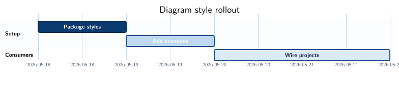 |
| gitgraph |  |
| journey | 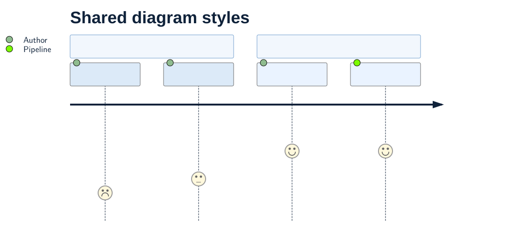 |
| kanban |  |
| pie | 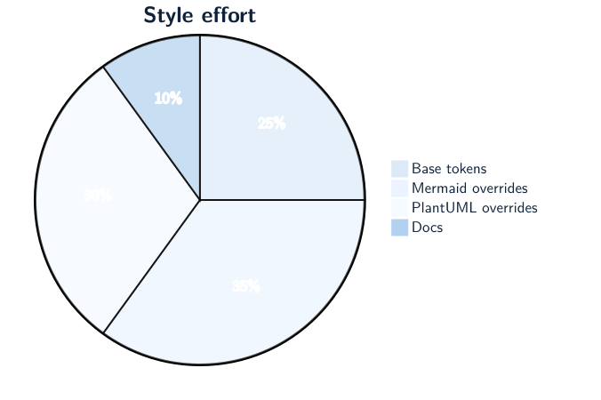 |
| quadrantchart | 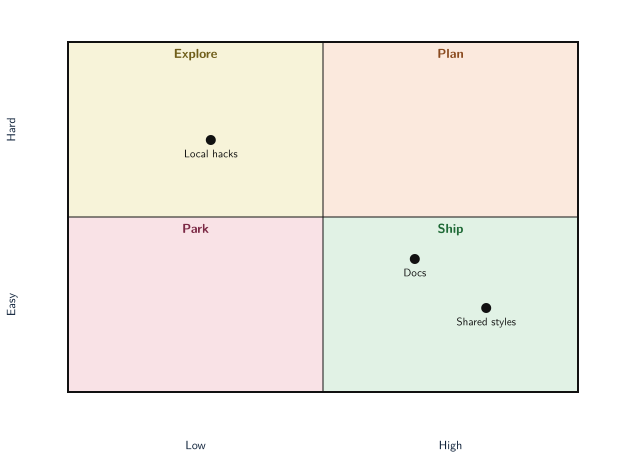 |
| sankey | 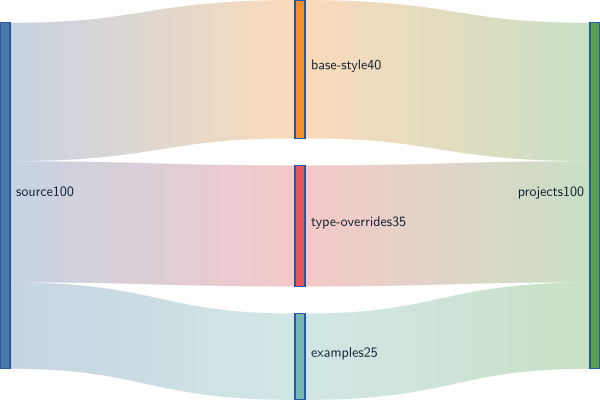 |
| sequence | 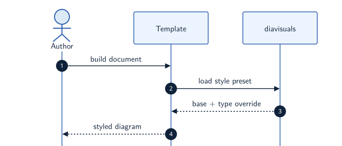 |
| state |  |
| timeline | 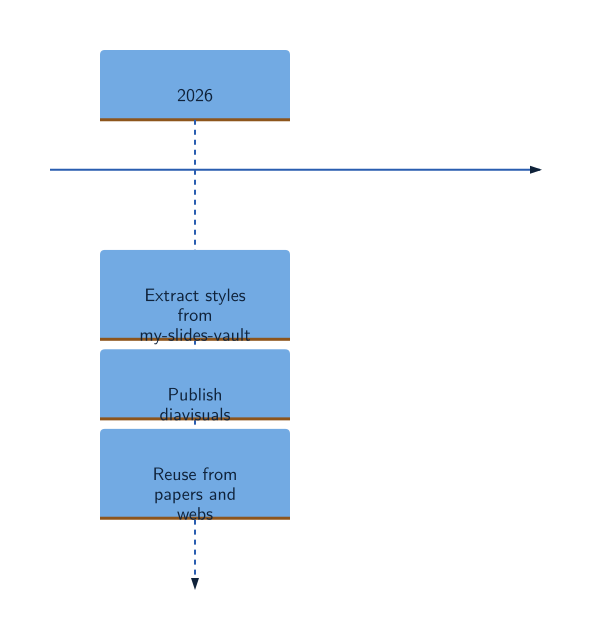 |
| treemap | 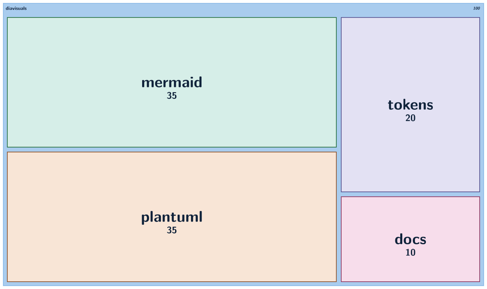 |

## PlantUML

| Type | Render |
| --- | --- |
| activity | 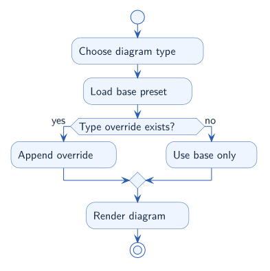 |
| class | 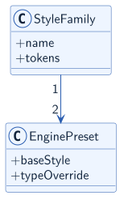 |
| component | 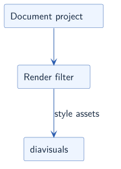 |
| deployment | 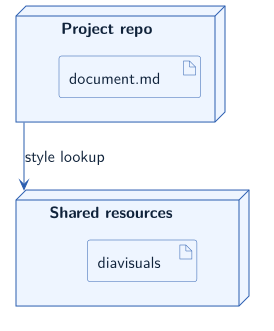 |
| files |  |
| gantt | 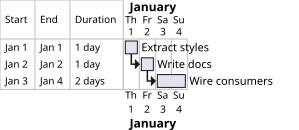 |
| json | 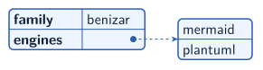 |
| mindmap | 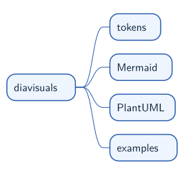 |
| object | 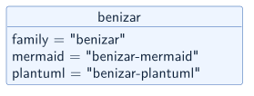 |
| salt |  |
| sequence | 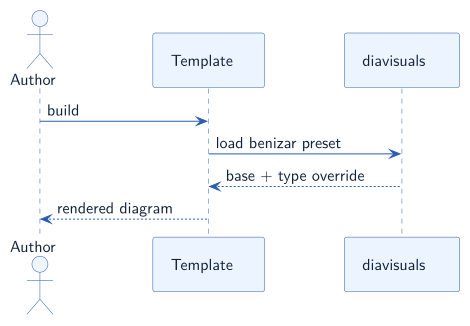 |
| state | 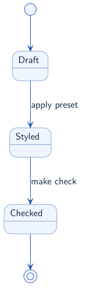 |
| usecase | 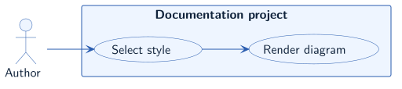 |
| wbs | 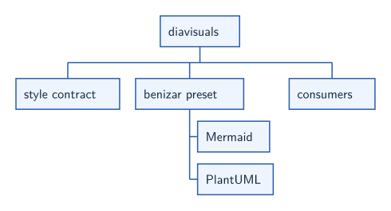 |
| yaml |  |

## Historical profiles

Earlier galleries remain under `gallery/benizar/`, including the unchanged
`mermaid-11.16.0-plantuml-1.2026.1` gallery. They document their own published
tuples and are not regenerated by the current default target.
